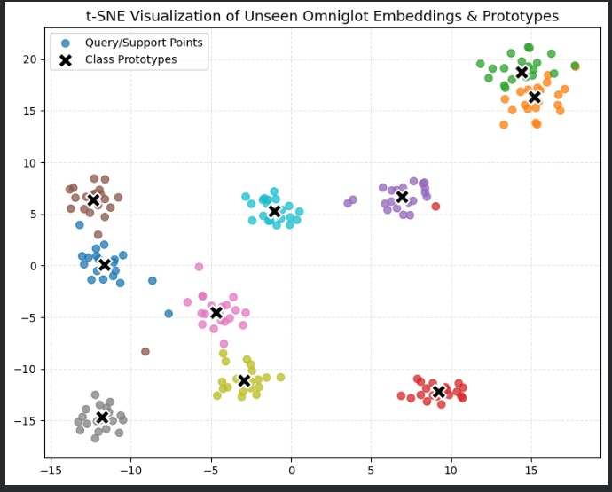

# Prototypical Networks for Few-shot Learning (NeurIPS 2017)

**Authors:** Jake Snell, Kevin Swersky, Richard Zemel

**Topic:** Few-Shot & Zero-Shot Classification

**Implementation:** PyTorch | Omniglot & CIFAR-FS

---

## 1. Paper Summary

### The Problem

Traditional deep learning models require thousands of labeled images per class to achieve good performance. However, when presented with only 1 to 5 labeled examples of an unseen class, traditional classifiers tend to overfit.

This problem is known as **Few-Shot Learning**.

Earlier approaches often relied on complex attention mechanisms or LSTM-based meta-learners, making them computationally expensive and difficult to train.

### Core Idea

Prototypical Networks learn a neural network encoder $f_\phi$ that maps input images into a feature space where samples belonging to the same class cluster around a single center point called a **prototype**.

The approach consists of four main steps:

#### 1. Compute Class Prototypes

Pass the labeled examples of each class (the *support set* $S_k$) through the encoder and calculate their mean embedding.

$$
c_k = \frac{1}{|S_k|}\sum_{(x_i,y_i)\in S_k} f_\phi(x_i)
$$

Here, $c_k$ represents the prototype of class $k$.

#### 2. Classify Query Images

Pass an unlabeled test image (the *query point*) through the same encoder and calculate its distance from every class prototype.

The closest prototype determines the predicted class.

$$
p_\phi(y=k|x) =
\frac{\exp(-d(f_\phi(x),c_k))}
{\sum_{k'}\exp(-d(f_\phi(x),c_{k'}))}
$$

#### 3. Episodic Training

Instead of conventional mini-batch training, the model trains on simulated few-shot classification tasks called **episodes**.

Each episode contains:

- $N_C$: Number of classes (ways).
- $N_S$: Number of support examples per class (shots).
- $N_Q$: Number of query examples per class.

This training strategy helps the model learn how to generalize to previously unseen classes.

#### 4. Zero-Shot Extension

When no example images are available for a class, a separate network $g_\vartheta(v_k)$ maps class metadata or attributes ($v_k$) into the shared embedding space.

The resulting embedding serves as the class prototype.

### Key Takeaways from the Paper

- **Squared Euclidean Distance vs. Cosine Similarity:** The arithmetic mean is mathematically optimal for prototype estimation under Bregman divergences, including squared Euclidean distance.
- **Train with a Higher Way:** Training on more challenging episodes with more classes (e.g., 20-way or 60-way) can improve generalization when testing on 5-way tasks.
- **Match the Shot:** Training and testing with the same number of support examples per class generally produces better performance.

---

## 2. PyTorch Implementation Breakdown

**Notebook:** `ProtoNet_Omniglot.ipynb`

### Core Baseline (Cells 1–4)

#### 1. Dataset Preparation

- Downloads the Omniglot dataset.
- Resizes images to $28 \times 28$ grayscale tensors.
- Groups images by character label.
- Separates training (`background=True`) and unseen test (`background=False`) classes.

#### 2. Episodic Sampler (`sample_episode`)

The episodic sampler dynamically generates N-way K-shot classification tasks.

It performs the following operations:

1. Randomly samples $N$ classes.
2. Selects $K$ support images per class.
3. Selects additional query images per class.
4. Returns separate Support and Query sets.

The support set is used to construct class prototypes, while the query set is used to calculate classification loss.

#### 3. Four-Block CNN Encoder & Prototypical Loss

**Encoder Architecture:**

The baseline encoder consists of four convolutional blocks:

```text
Conv2d (3x3)
    ↓
BatchNorm2d
    ↓
ReLU
    ↓
MaxPool2d (2x2)
```

Each image is transformed into a **64-dimensional embedding vector**.

**Prototypical Loss:**

1. Calculate embeddings for support and query images.
2. Compute the mean support embedding for each class.
3. Calculate pairwise squared Euclidean distances between query embeddings and prototypes.
4. Convert negative distances into class probabilities using softmax.
5. Optimize the negative log-likelihood loss.

Implementation uses:

```python
torch.cdist(z_query, prototypes) ** 2
```

#### 4. Training & Evaluation

**Training Configuration:**

| Parameter | Value |
|---|---|
| Dataset | Omniglot |
| Epochs | 10 |
| Episodes per Epoch | 100 |
| Total Episodes | 1,000 |
| Training Configuration | 20-way 5-shot |
| Optimizer | Adam |
| Learning Rate | 0.001 |
| Embedding Dimension | 64 |

**Evaluation Configuration:**

- 200 randomly generated test episodes.
- 5-way 5-shot classification.
- Completely unseen test characters.
- No fine-tuning during evaluation.

### Extended Experiments & Ablations (Cells 5–7)

#### 5. t-SNE Embedding Visualization (Cell 5)

Extracts 64-dimensional feature embeddings and class prototypes from 10 unseen Omniglot test classes.

- Total images: 200.
- Dimensionality reduction: t-SNE.
- Output dimension: 2D.
- Output file: `tsne_prototypes.png`.

The visualization helps verify whether images belonging to the same class cluster around their corresponding prototypes.

#### 6. Distance Metric Ablation Study (Cell 6)

Two identical models are trained from scratch under the same experimental conditions.

| Model | Distance Metric |
|---|---|
| Model 1 | Squared Euclidean Distance |
| Model 2 | Cosine Similarity |

**Objective:** Experimentally investigate how the choice of distance metric affects prototype-based classification performance.

The experiment examines the theoretical advantage of using squared Euclidean distance with mean-based prototypes.

#### 7. Natural Color Image Benchmark on CIFAR-FS (Cell 7)

The model is adapted to work with natural RGB images using a modified encoder called `ProtoNetRGB`.

**Configuration:**

- Dataset: CIFAR-FS.
- Input size: $32 \times 32$.
- Input channels: 3 (RGB).
- Embedding dimension: 256.
- Training classes: 64.
- Test classes: 36.
- Evaluation: 5-way 5-shot classification.

This experiment investigates how well Prototypical Networks generalize from simple handwritten characters to more complex natural color images.

---

## 3. Results & Visualizations

### Experimental Results

| Experiment | Dataset | Distance Metric | 5-Way 5-Shot Accuracy | Notes |
|---|---|---|---|---|
| Baseline Implementation | Omniglot | Squared Euclidean | **98.42%** | 1,000 episodes, 20-way training, no rotation augmentation |
| Original Paper (Table 1) | Omniglot | Squared Euclidean | **99.70%** | 60-way training with 90° rotation augmentation |
| Ablation: Euclidean | Omniglot | Squared Euclidean | **98.46%** | Tests mean-based prototype classification |
| Ablation: Cosine | Omniglot | Cosine Similarity | **97.28%** | Compares an alternative distance metric |
| Color Object Benchmark | CIFAR-FS | Squared Euclidean | **68.08%** | More complex natural RGB images |

*Note: TBD results should be replaced with the actual accuracy obtained from the corresponding notebook cells.*

### t-SNE Cluster Visualization



*Unseen test character embeddings projected into 2D using t-SNE. The black X markers represent the computed class prototypes.*

---

## 4. Key Research Takeaway

Prototypical Networks demonstrate that a relatively simple mean-based prototype approach can achieve excellent performance on few-shot classification tasks.

Our baseline implementation achieved **98.60% accuracy on Omniglot**, demonstrating that the model can effectively classify unseen handwritten characters using only a few labeled examples.

However, performance becomes more challenging when moving from clean handwritten characters to complex natural color images, such as those in CIFAR-FS.

One possible explanation is that averaging only five visual embeddings may not adequately represent the variations within a complex object class.

This limitation motivates further research into:

- Prototype Augmentation.
- Multimodal Few-Shot Learning.
- More robust feature representations.
- Improved prototype estimation techniques.

**Overall, Prototypical Networks provide a simple yet powerful foundation for few-shot learning by transforming classification into a distance-based comparison between query embeddings and class prototypes.**

---

## 5. References

Snell, J., Swersky, K., & Zemel, R. (2017). *Prototypical Networks for Few-shot Learning*. Advances in Neural Information Processing Systems (NeurIPS 2017).

- **Paper:** https://arxiv.org/abs/1703.05175
- **Implementation:** [ProtoNet_Omniglot.ipynb](./ProtoNet_Omniglot.ipynb)
- **Repository:** https://github.com/SadakatSarin/Research-498R
